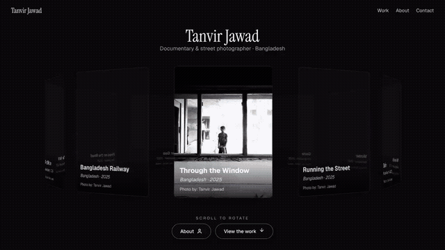

# Tanvir Jawad — Photography Portfolio

A one-page portfolio for **Tanvir Jawad**, a documentary and street photographer from Bangladesh. It opens with a rotating 3D gallery of his best shots, then shows all 20 photographs with titles and short stories.

### ▶ [View the live site](https://tanvirjawad-photography-showcase.vercel.app)



## 🎬 Demo video

<!-- Drag media/demo.mp4 here in GitHub's web editor and it will become a playable video -->

## What's on the page

- **3D hero gallery** — 12 featured photos on a rotating ring. It turns on its own and with your scroll.
- **Selected Work** — all 20 photos in a responsive 1/2/3-column grid, each with a title, place · year and description.
- **Lightbox** — click any photo to see it full size; use ← / → to move between photos.
- **About + Contact** — a short bio of the photographer.
- **Fast and phone-friendly** — 20 originals (≈135 MB) were optimised to WebP in two sizes (≈11 MB total), card sizes scale with the screen, and auto-rotation turns off for people who prefer reduced motion.

## Built with

| Part | What's used |
|---|---|
| Framework | React 19 + TypeScript, bundled with Vite |
| Styling | Tailwind CSS v4, shadcn/ui |
| Hero | 21st.dev `CircularGallery`, reworked (smooth scroll rotation, auto-fit radius, keyboard support) |
| Fonts | Instrument Serif + Geist |
| Hosting | Vercel |

## Run it locally

```bash
npm install
npm run dev      # http://localhost:5173
npm run build    # production build in dist/
```

See `PLAN.md` for the roadmap and `CLAUDE.md` for project conventions.

---
Photographs © Tanvir Jawad. Website by [Rafid Tanim](https://github.com/RafTan10).
